# 房产销售系统

> 🎓 **计算机毕业设计 · 房产销售系统**
>
> 本仓库只放**项目介绍 + 运行截图**（截图是站点带水印的原图，存在仓库 `images/` 里）。
>
> 👉 **完整可运行源码 / 数据库脚本 / 部署文档：[点我获取](https://geekcode.top/archives/%E6%88%BF%E4%BA%A7%E9%94%80%E5%94%AE%E7%B3%BB%E7%BB%9F?utm_source=github)**
>
> 💬 咨询微信：**ir9372**　|　🌐 更多项目：[极客代码 geekcode.top](https://geekcode.top/?utm_source=github)
>
> 📌 项目详情页：<https://geekcode.top/archives/%E6%88%BF%E4%BA%A7%E9%94%80%E5%94%AE%E7%B3%BB%E7%BB%9F?utm_source=github>

<table><td width="230" align="center"> <b>扫码加微信 ir9372</b></td><td valign="middle">📦 源码 = 项目介绍 + 全部运行截图 + 数据库 + 部署文档 👉 点上方任意截图，直接跳到 <b>极客代码 geekcode.top</b> 详情页</td></table>

---

<h1>房产销售系统</h1>
<h2>项目概述</h2>

房产销售系统面向房源展示与销售管理场景，提供前台用户端与后台管理端。前台支持用户注册登录、浏览房源信息、按房源类型和房子户型查看销售信息、收藏房源、评论房源、预约看房、查看交易订单与评价；后台支持管理员维护房源、类型、户型、销售经理、预约、订单、评价、评论、用户、收藏和轮播图配置。系统采用 Spring Boot 后端、MyBatis-Plus 数据访问、Shiro 认证授权，并以 Vue 集成方式构建前端页面，实现房产销售业务的线上化管理。

<h2>技术架构</h2>
<h3>前后端架构</h3>

项目类型为 vue-integrated，前端页面以 Vue 集成为主，分为前台用户端与后台管理端。前台通过首页、登录注册、房源信息、个人中心、我的收藏等页面与后端交互；后台通过业务路由进入房源信息、预约看房、交易订单、用户、评价、收藏、销售经理、房源类型、房子户型、房源信息评论和轮播图管理等模块。

后端由 Spring Boot 提供应用运行与接口处理能力，控制器层包括 CommonController、ConfigController、DiscussfangyuanxinxiController、FangyuanleixingController、FangyuanxinxiController、FangzihuxingController、FileController、JiaoyidingdanController、PingjiaController、StoreupController、UserController、XiaoshoujingliController，分别承担通用处理、配置管理、评论管理、房源类型管理、房源信息管理、房子户型管理、文件处理、交易订单管理、评价管理、收藏管理、用户管理和销售经理管理等职责。

<a href="https://geekcode.top/archives/%E6%88%BF%E4%BA%A7%E9%94%80%E5%94%AE%E7%B3%BB%E7%BB%9F?utm_source=github" title="查看完整源码">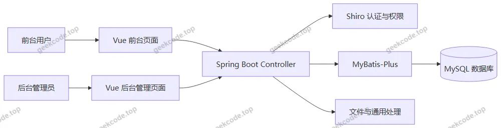</a>

<h3>数据库设计要点</h3>

系统数据围绕房产销售业务组织，以房源信息为核心，连接房源类型、房子户型、销售经理、用户、预约看房、交易订单、评价、房源信息评论、我的收藏和系统配置等数据实体。房源信息可与房源类型、房子户型、销售经理形成基础业务关联；用户可与收藏、评论、预约看房、交易订单、评价形成业务关联；后台管理端对上述数据进行统一维护与查询。

<h3>核心技术选型理由</h3>

Spring Boot 用于快速构建 Web 应用，简化配置并集成控制器、数据源和依赖管理。MyBatis-Plus 用于持久层开发，提供通用 CRUD 能力，适合后台管理系统中大量增删改查场景。Shiro 用于身份认证、授权和会话管理，满足前台用户与后台管理员的访问控制需求。MySQL 作为关系型数据库，适合存储房源、订单、预约、评论、收藏等结构化业务数据。validation-api 用于参数校验，commons-lang3 提供通用工具支持，protobuf-java 作为项目依赖参与相关数据处理。

<h2>功能模块</h2>
<h3>前台用户端功能模块</h3>
<table>
<thead>
<tr>
<th>模块</th>
<th>功能描述</th>
</tr>
</thead>
<tbody><tr>
<td>前台首页</td>
<td>提供房产销售系统的用户端入口，展示房源信息及相关业务内容。</td>
</tr>
<tr>
<td>前台登录页</td>
<td>提供已注册用户登录入口，用于进入个人中心、收藏、订单、预约等功能。</td>
</tr>
<tr>
<td>前台注册页</td>
<td>提供新用户注册入口，用于创建前台用户账号。</td>
</tr>
<tr>
<td>房源信息列表</td>
<td>展示房源信息集合，支持用户浏览房源基础内容。</td>
</tr>
<tr>
<td>房源信息详情</td>
<td>展示单个房源的详细信息，便于用户了解房源情况。</td>
</tr>
<tr>
<td>房源信息评论列表</td>
<td>展示房源相关评论内容，便于用户查看其他用户的反馈信息。</td>
</tr>
<tr>
<td>房源信息评论详情</td>
<td>展示单条评论的详细内容。</td>
</tr>
<tr>
<td>房源类型列表</td>
<td>展示房源类型信息，用于分类查看房源内容。</td>
</tr>
<tr>
<td>房子户型列表</td>
<td>展示房子户型信息，用于按户型维度浏览房源。</td>
</tr>
<tr>
<td>销售经理列表</td>
<td>展示销售经理信息，用于查看房源销售相关人员信息。</td>
</tr>
<tr>
<td>预约看房列表</td>
<td>展示预约看房记录，便于用户查看预约情况。</td>
</tr>
<tr>
<td>预约看房详情</td>
<td>展示单条预约看房记录的详细信息。</td>
</tr>
<tr>
<td>交易订单列表</td>
<td>展示交易订单记录，便于用户查看订单情况。</td>
</tr>
<tr>
<td>交易订单详情</td>
<td>展示单笔交易订单的详细信息。</td>
</tr>
<tr>
<td>评价列表</td>
<td>展示评价记录，便于用户查看评价内容。</td>
</tr>
<tr>
<td>个人中心</td>
<td>提供用户个人信息与业务数据入口。</td>
</tr>
<tr>
<td>我的收藏列表</td>
<td>展示用户收藏的房源信息，便于后续查看与管理。</td>
</tr>
</tbody></table>
<h3>后台管理端功能模块</h3>
<table>
<thead>
<tr>
<th>模块</th>
<th>功能描述</th>
</tr>
</thead>
<tbody><tr>
<td>后台登录页</td>
<td>提供管理员进入后台管理系统的入口。</td>
</tr>
<tr>
<td>后台首页</td>
<td>展示后台管理主界面，用于进入各业务管理模块。</td>
</tr>
<tr>
<td>房源信息管理</td>
<td>维护房源信息数据，支撑前台房源展示与查询。</td>
</tr>
<tr>
<td>房源类型管理</td>
<td>维护房源类型数据，用于房源分类管理。</td>
</tr>
<tr>
<td>房子户型管理</td>
<td>维护房子户型数据，用于房源户型信息展示。</td>
</tr>
<tr>
<td>销售经理管理</td>
<td>维护销售经理信息，用于关联房源销售业务。</td>
</tr>
<tr>
<td>预约看房管理</td>
<td>维护预约看房数据，查看和管理用户预约记录。</td>
</tr>
<tr>
<td>交易订单管理</td>
<td>维护交易订单数据，查看和管理订单信息。</td>
</tr>
<tr>
<td>评价管理</td>
<td>维护评价数据，查看和管理用户评价记录。</td>
</tr>
<tr>
<td>房源信息评论管理</td>
<td>维护房源信息评论数据，管理前台评论内容。</td>
</tr>
<tr>
<td>用户管理</td>
<td>维护用户信息，管理前台注册用户数据。</td>
</tr>
<tr>
<td>我的收藏管理</td>
<td>维护收藏数据，查看和管理用户收藏记录。</td>
</tr>
<tr>
<td>轮播图管理</td>
<td>维护系统配置与轮播图相关数据，支撑首页展示内容管理。</td>
</tr>
</tbody></table>
<h2>用户角色与权限</h2>
<h3>前台用户</h3>

前台用户通过前台登录页进入系统，可访问以下功能模块：

<table>
<thead>
<tr>
<th>权限范围</th>
<th>可访问功能</th>
</tr>
</thead>
<tbody><tr>
<td>用户基础操作</td>
<td>前台注册、前台登录、前台首页、个人中心</td>
</tr>
<tr>
<td>房源浏览</td>
<td>房源信息列表、房源信息详情、房源类型列表、房子户型列表、销售经理列表</td>
</tr>
<tr>
<td>房源互动</td>
<td>房源信息评论列表、房源信息评论详情、我的收藏列表</td>
</tr>
<tr>
<td>业务记录查看</td>
<td>预约看房列表、预约看房详情、交易订单列表、交易订单详情、评价列表</td>
</tr>
</tbody></table>
<h3>后台管理员</h3>

后台管理员通过后台登录页进入系统，可访问以下功能模块：

<table>
<thead>
<tr>
<th>权限范围</th>
<th>可访问功能</th>
</tr>
</thead>
<tbody><tr>
<td>系统入口</td>
<td>后台登录页、后台首页</td>
</tr>
<tr>
<td>房源基础数据管理</td>
<td>房源信息管理、房源类型管理、房子户型管理、销售经理管理</td>
</tr>
<tr>
<td>交易与预约管理</td>
<td>预约看房管理、交易订单管理、评价管理</td>
</tr>
<tr>
<td>用户与互动数据管理</td>
<td>用户管理、房源信息评论管理、我的收藏管理</td>
</tr>
<tr>
<td>系统展示配置管理</td>
<td>轮播图管理</td>
</tr>
</tbody></table>
<h2>项目特色与创新点</h2>
<ol>
<li>
<strong>房产销售业务闭环管理</strong>：系统覆盖房源展示、房源分类、户型信息、销售经理信息、预约看房、交易订单、评价、评论和收藏等业务内容，形成较完整的房产销售线上管理流程。

</li>
<li>
<strong>前台用户端与后台管理端协同</strong>：前台用户可浏览房源、收藏、评论、预约、查看订单与评价；后台管理员可维护房源、用户、订单、预约、评论、收藏、销售经理和轮播图配置，两端围绕同一业务数据展开管理。

</li>
<li>
<strong>核心数据模型清晰</strong>：以房源信息为中心，关联房源类型、房子户型、销售经理、用户、预约看房、交易订单、评价、评论和收藏等模块，便于进行房源业务数据组织与查询。

</li>
<li>
<strong>技术选型成熟稳定</strong>：采用 Spring Boot 构建后端应用，使用 MyBatis-Plus 简化数据访问层开发，通过 Shiro 实现认证与权限控制，适合毕业设计中的管理系统开发场景。

</li>
<li>
<strong>Vue 集成方式提升页面组织能力</strong>：项目采用 vue-integrated 类型，前端页面与后端业务模块协同，能够支撑前台展示与后台管理两类界面需求。

</li>
</ol>
<h2>部署环境</h2>
<table>
<thead>
<tr>
<th>环境项</th>
<th>用途</th>
</tr>
</thead>
<tbody><tr>
<td>Java 运行环境 JDK</td>
<td>运行 Spring Boot 后端应用</td>
</tr>
<tr>
<td>MySQL 数据库</td>
<td>存储房源、用户、订单、预约、评论、收藏、配置等业务数据</td>
</tr>
<tr>
<td>Web 应用运行容器</td>
<td>承载 Spring Boot 后端应用，可由 Spring Boot 内嵌容器提供</td>
</tr>
<tr>
<td>Node.js</td>
<td>用于 Vue 集成前端资源的构建与打包阶段</td>
</tr>
<tr>
<td>浏览器</td>
<td>访问前台用户端与后台管理端页面</td>
</tr>
<tr>
<td>依赖库</td>
<td>包括 spring-boot-starter-web、mybatis-spring-boot-starter、spring-boot-starter-jdbc、mysql-connector-java、shiro-spring、mybatis-plus、mybatisplus-spring-boot-starter、protobuf-java、commons-lang3、validation-api</td>
</tr>
</tbody></table>
<h2>五、技术特性</h2>
<ul>
<li>前后端集成部署，前端资源打包至后端 static 目录</li>
<li>使用 MyBatis-Plus 简化数据访问层开发</li>
<li>集成 Shiro 权限框架实现角色权限控制</li>
</ul>
<h2>六、功能模块截图</h2>
<h3>前台用户端</h3>
<h4>前台首页</h4>

<a href="https://geekcode.top/archives/%E6%88%BF%E4%BA%A7%E9%94%80%E5%94%AE%E7%B3%BB%E7%BB%9F?utm_source=github" title="查看完整源码">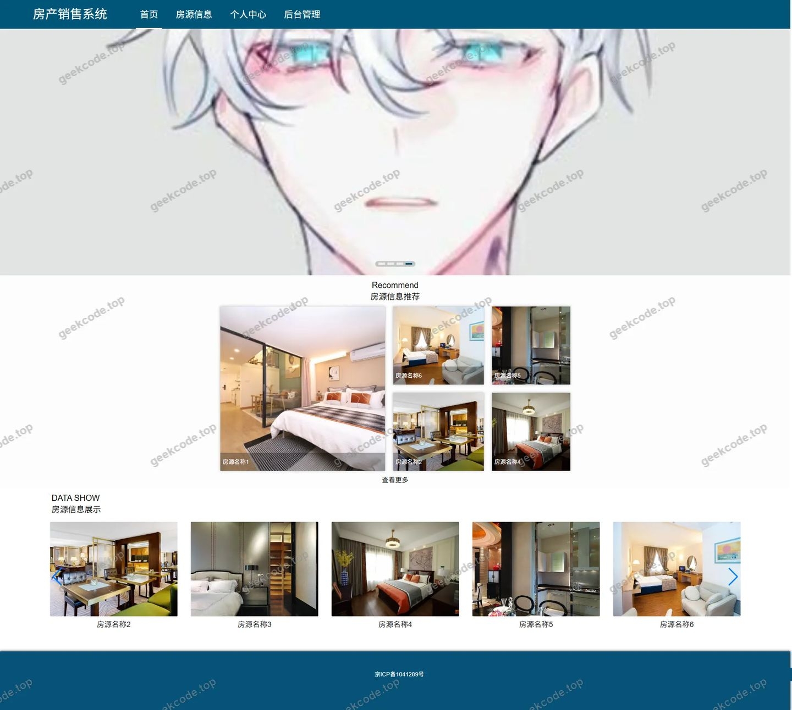</a>

<h4>前台登录页</h4>

<a href="https://geekcode.top/archives/%E6%88%BF%E4%BA%A7%E9%94%80%E5%94%AE%E7%B3%BB%E7%BB%9F?utm_source=github" title="查看完整源码">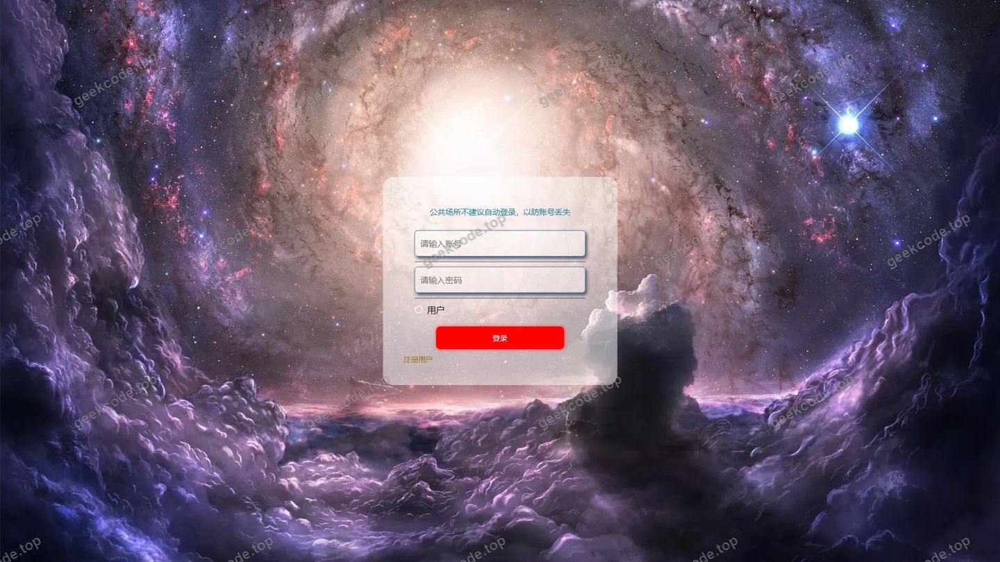</a>

<h4>前台注册页</h4>

<a href="https://geekcode.top/archives/%E6%88%BF%E4%BA%A7%E9%94%80%E5%94%AE%E7%B3%BB%E7%BB%9F?utm_source=github" title="查看完整源码">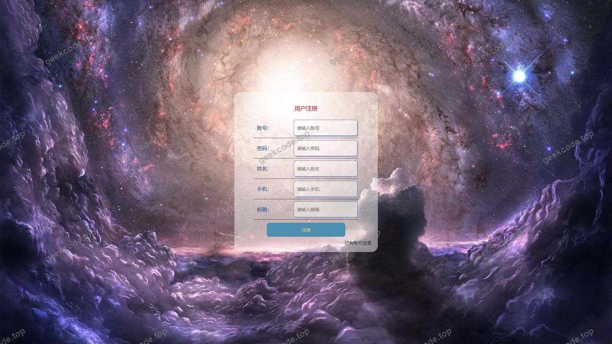</a>

<h4>前台-房源信息列表</h4>

<a href="https://geekcode.top/archives/%E6%88%BF%E4%BA%A7%E9%94%80%E5%94%AE%E7%B3%BB%E7%BB%9F?utm_source=github" title="查看完整源码">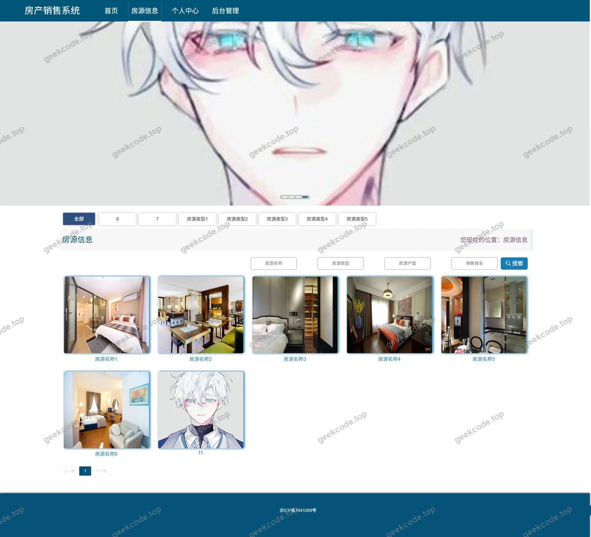</a>

<h4>前台-房源信息评论列表</h4>

<a href="https://geekcode.top/archives/%E6%88%BF%E4%BA%A7%E9%94%80%E5%94%AE%E7%B3%BB%E7%BB%9F?utm_source=github" title="查看完整源码">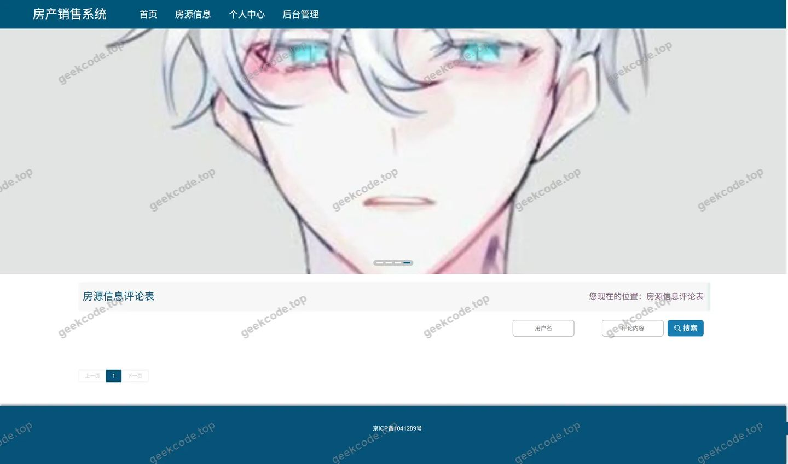</a>

<h4>前台个人中心</h4>

<a href="https://geekcode.top/archives/%E6%88%BF%E4%BA%A7%E9%94%80%E5%94%AE%E7%B3%BB%E7%BB%9F?utm_source=github" title="查看完整源码">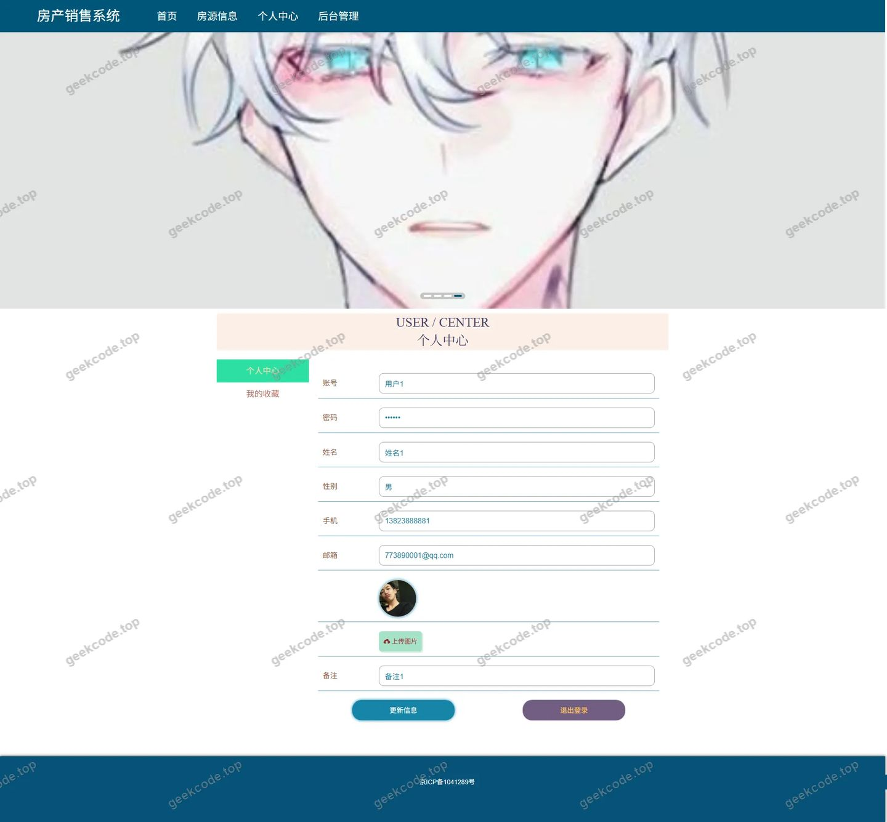</a>

<h4>前台-我的收藏列表</h4>

<a href="https://geekcode.top/archives/%E6%88%BF%E4%BA%A7%E9%94%80%E5%94%AE%E7%B3%BB%E7%BB%9F?utm_source=github" title="查看完整源码">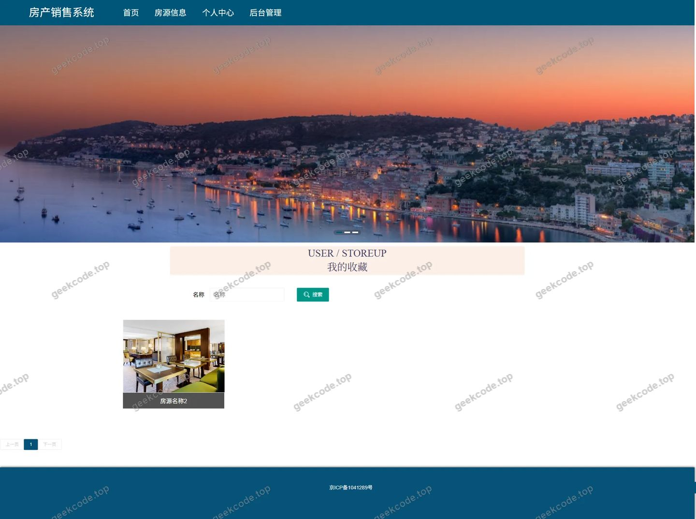</a>

<h4>前台-房源信息-详情</h4>

<a href="https://geekcode.top/archives/%E6%88%BF%E4%BA%A7%E9%94%80%E5%94%AE%E7%B3%BB%E7%BB%9F?utm_source=github" title="查看完整源码">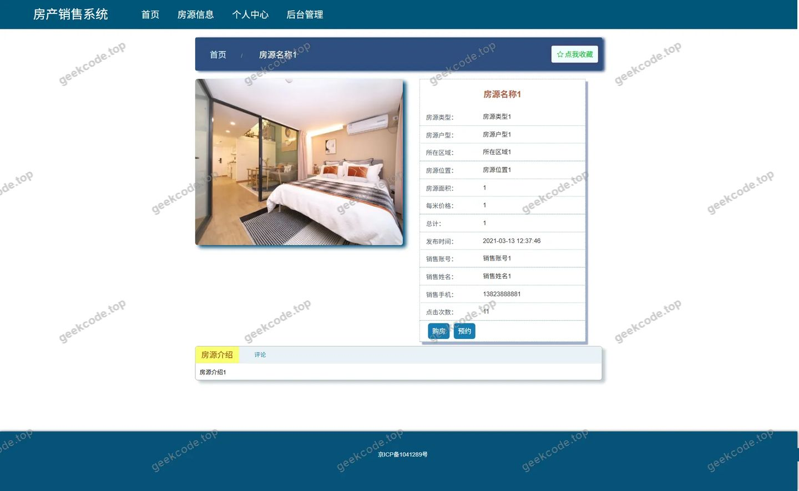</a>

<h4>前台-房源类型列表</h4>

<h4>前台-房子户型列表</h4>

<h4>前台-交易订单列表</h4>

<a href="https://geekcode.top/archives/%E6%88%BF%E4%BA%A7%E9%94%80%E5%94%AE%E7%B3%BB%E7%BB%9F?utm_source=github" title="查看完整源码">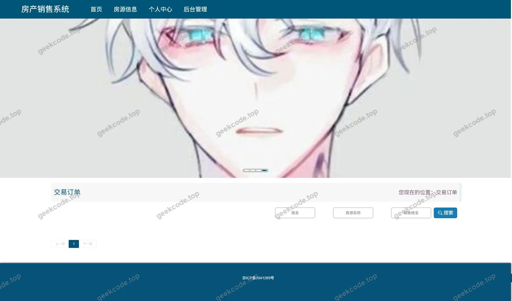</a>

<h4>前台-评价列表</h4>

<a href="https://geekcode.top/archives/%E6%88%BF%E4%BA%A7%E9%94%80%E5%94%AE%E7%B3%BB%E7%BB%9F?utm_source=github" title="查看完整源码">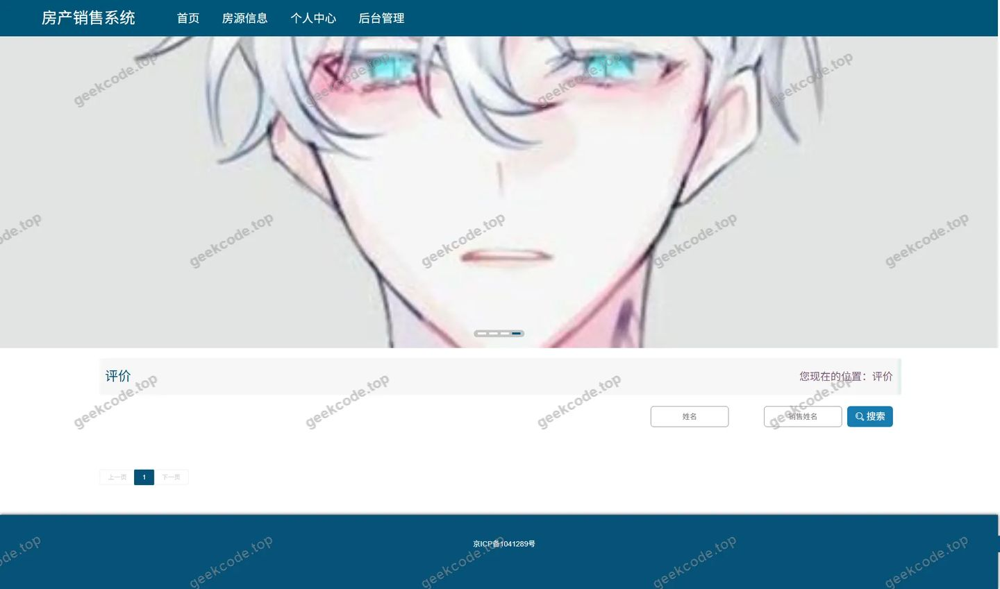</a>

<h4>前台-销售经理列表</h4>

<a href="https://geekcode.top/archives/%E6%88%BF%E4%BA%A7%E9%94%80%E5%94%AE%E7%B3%BB%E7%BB%9F?utm_source=github" title="查看完整源码">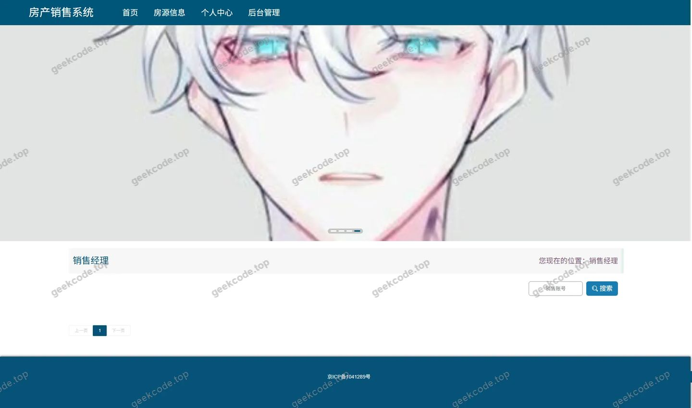</a>

<h4>前台-预约看房列表</h4>

<a href="https://geekcode.top/archives/%E6%88%BF%E4%BA%A7%E9%94%80%E5%94%AE%E7%B3%BB%E7%BB%9F?utm_source=github" title="查看完整源码">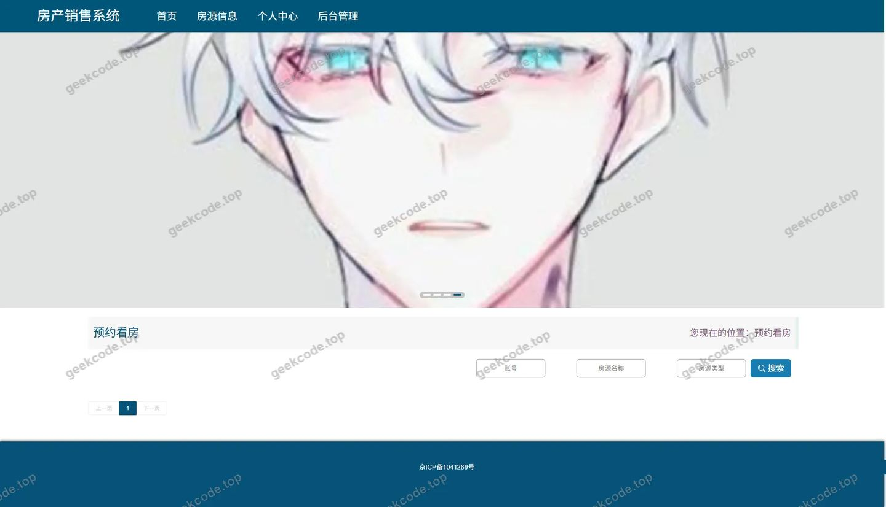</a>

<h4>前台-房源信息评论-详情</h4>

<a href="https://geekcode.top/archives/%E6%88%BF%E4%BA%A7%E9%94%80%E5%94%AE%E7%B3%BB%E7%BB%9F?utm_source=github" title="查看完整源码">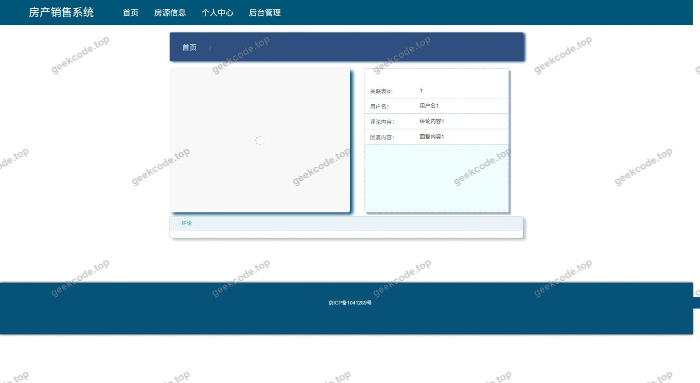</a>

<h4>前台-交易订单-详情</h4>

<a href="https://geekcode.top/archives/%E6%88%BF%E4%BA%A7%E9%94%80%E5%94%AE%E7%B3%BB%E7%BB%9F?utm_source=github" title="查看完整源码">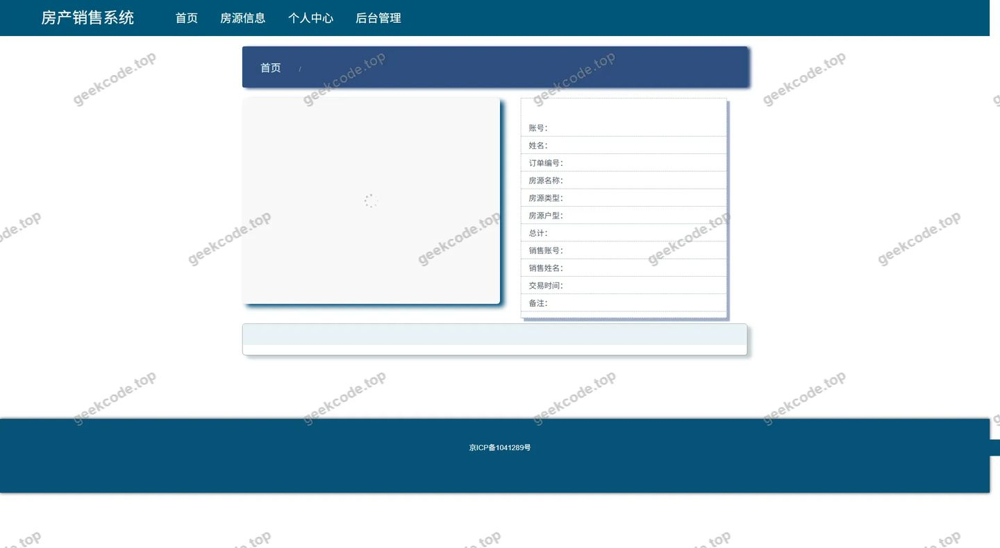</a>

<h4>前台-预约看房-详情</h4>

<a href="https://geekcode.top/archives/%E6%88%BF%E4%BA%A7%E9%94%80%E5%94%AE%E7%B3%BB%E7%BB%9F?utm_source=github" title="查看完整源码">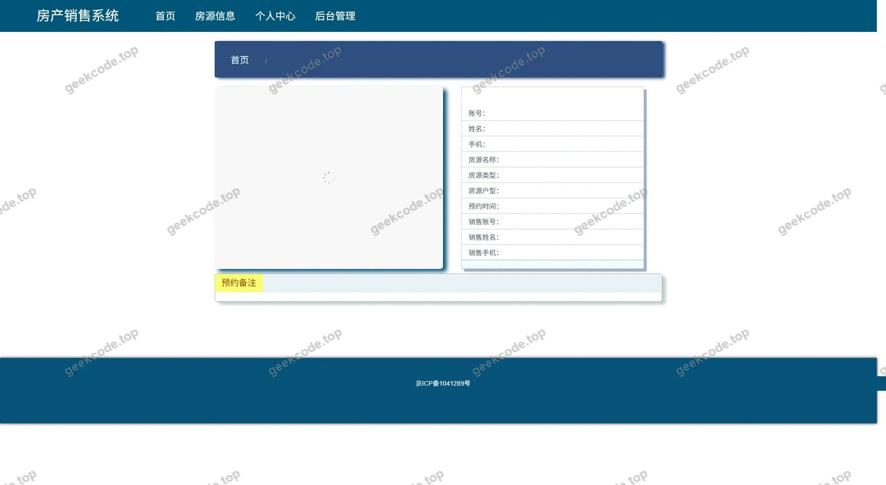</a>

<h3>后台管理端</h3>
<h4>后台-系统配置</h4>

<a href="https://geekcode.top/archives/%E6%88%BF%E4%BA%A7%E9%94%80%E5%94%AE%E7%B3%BB%E7%BB%9F?utm_source=github" title="查看完整源码">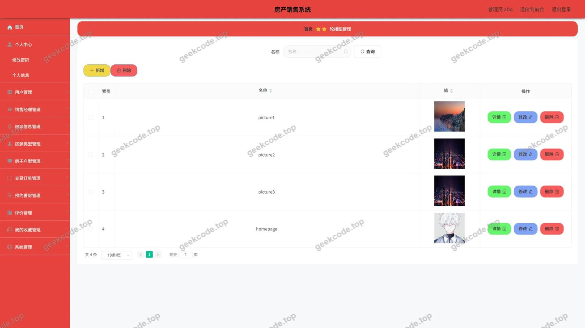</a>

<h4>后台-房源信息评论</h4>

<a href="https://geekcode.top/archives/%E6%88%BF%E4%BA%A7%E9%94%80%E5%94%AE%E7%B3%BB%E7%BB%9F?utm_source=github" title="查看完整源码">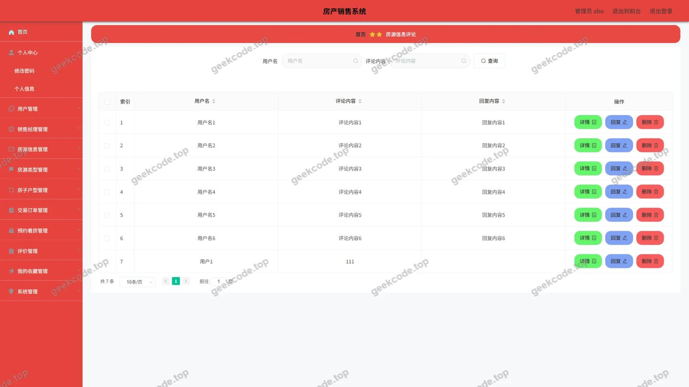</a>

<h4>后台-房源类型</h4>

<h4>后台-房源信息</h4>

<a href="https://geekcode.top/archives/%E6%88%BF%E4%BA%A7%E9%94%80%E5%94%AE%E7%B3%BB%E7%BB%9F?utm_source=github" title="查看完整源码">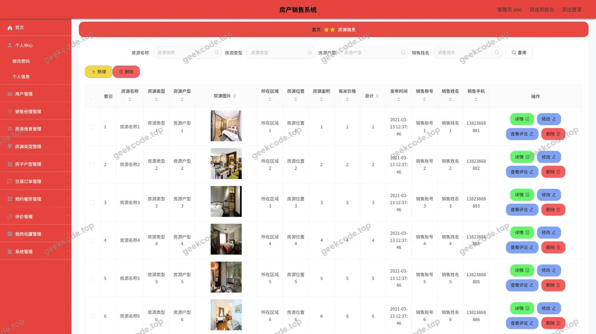</a>

<h4>后台-房子户型</h4>

<a href="https://geekcode.top/archives/%E6%88%BF%E4%BA%A7%E9%94%80%E5%94%AE%E7%B3%BB%E7%BB%9F?utm_source=github" title="查看完整源码">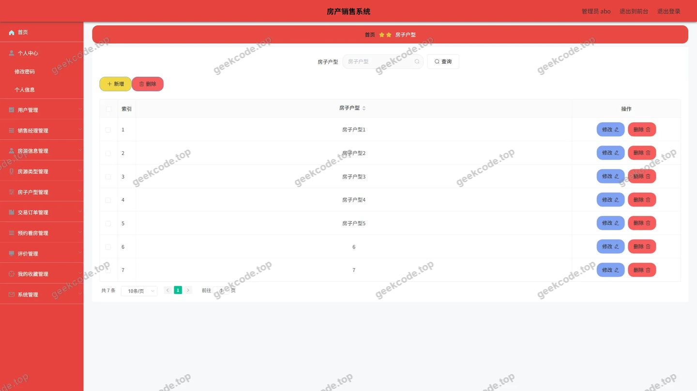</a>

<h4>后台首页</h4>

<a href="https://geekcode.top/archives/%E6%88%BF%E4%BA%A7%E9%94%80%E5%94%AE%E7%B3%BB%E7%BB%9F?utm_source=github" title="查看完整源码">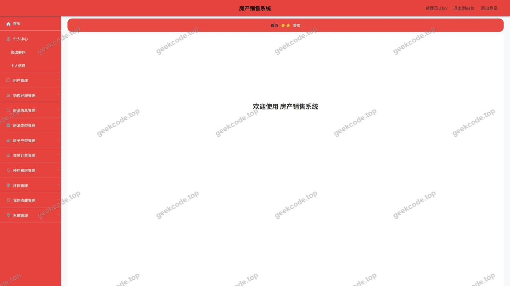</a>

<h4>后台-交易订单</h4>

<a href="https://geekcode.top/archives/%E6%88%BF%E4%BA%A7%E9%94%80%E5%94%AE%E7%B3%BB%E7%BB%9F?utm_source=github" title="查看完整源码">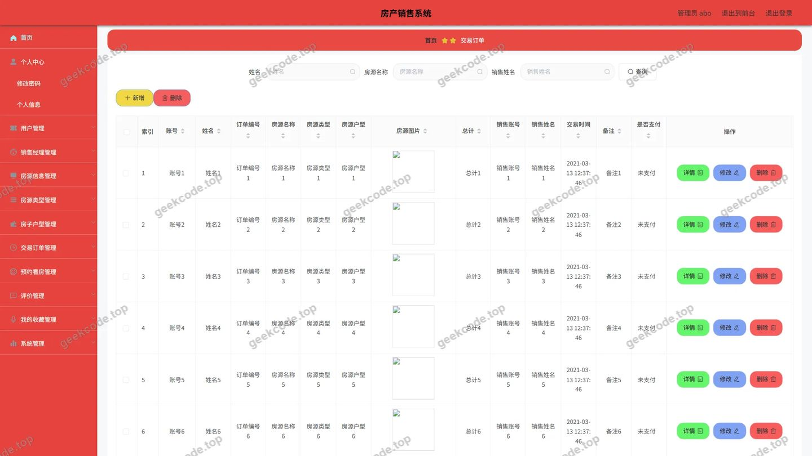</a>

<h4>后台-登录</h4>

<h4>后台-评价</h4>

<a href="https://geekcode.top/archives/%E6%88%BF%E4%BA%A7%E9%94%80%E5%94%AE%E7%B3%BB%E7%BB%9F?utm_source=github" title="查看完整源码">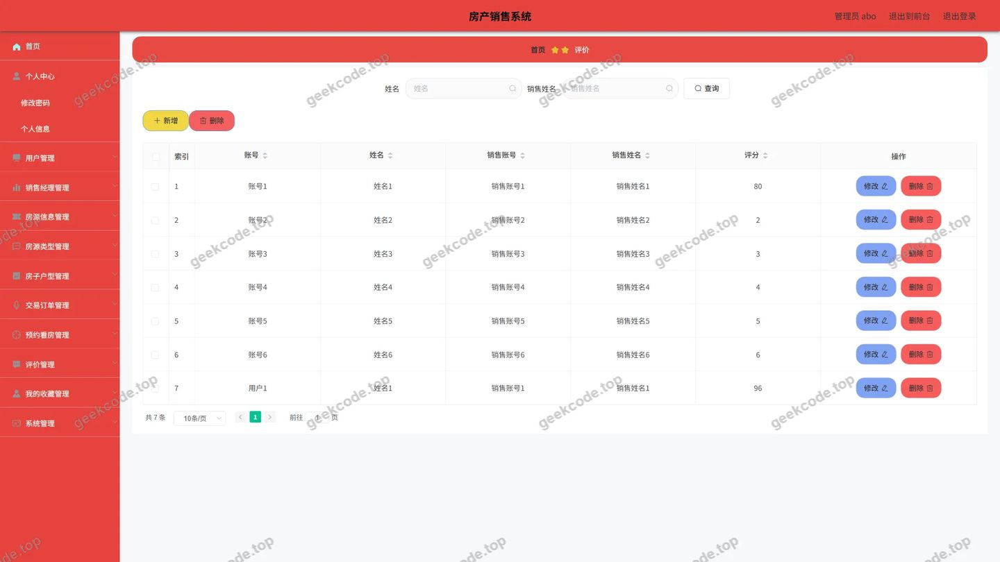</a>

<h4>后台-收藏</h4>

<a href="https://geekcode.top/archives/%E6%88%BF%E4%BA%A7%E9%94%80%E5%94%AE%E7%B3%BB%E7%BB%9F?utm_source=github" title="查看完整源码">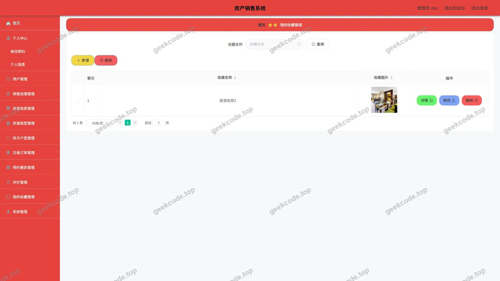</a>

<h4>后台-销售经理</h4>

<a href="https://geekcode.top/archives/%E6%88%BF%E4%BA%A7%E9%94%80%E5%94%AE%E7%B3%BB%E7%BB%9F?utm_source=github" title="查看完整源码">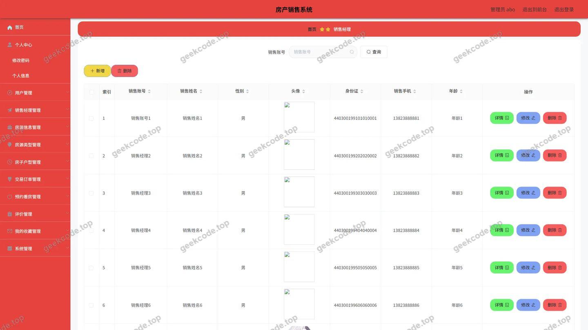</a>

<h4>后台-预约看房</h4>

<a href="https://geekcode.top/archives/%E6%88%BF%E4%BA%A7%E9%94%80%E5%94%AE%E7%B3%BB%E7%BB%9F?utm_source=github" title="查看完整源码">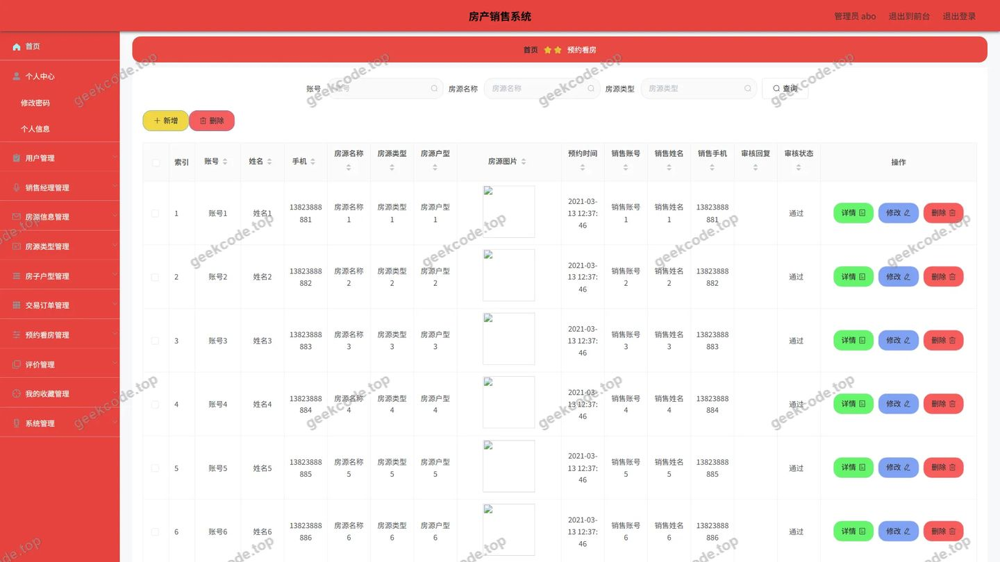</a>

---

## 获取完整源码

| 项目 | 说明 |
| --- | --- |
| 项目名 | 房产销售系统 |
| 运行截图 | 本文 30 张（站点带水印原图，仓库 `images/` 目录） |
| 完整源码 | [https://geekcode.top/archives/%E6%88%BF%E4%BA%A7%E9%94%80%E5%94%AE%E7%B3%BB%E7%BB%9F?utm_source=github](https://geekcode.top/archives/%E6%88%BF%E4%BA%A7%E9%94%80%E5%94%AE%E7%B3%BB%E7%BB%9F?utm_source=github) |
| 咨询微信 | **ir9372**（备注：jingpin-yuanma） |
| 更多项目 | [极客代码 geekcode.top](https://geekcode.top/?utm_source=github) |

> 需要源码、部署、改配置、跑不起来等问题，加微信 ir9372 沟通，说明项目名即可。
